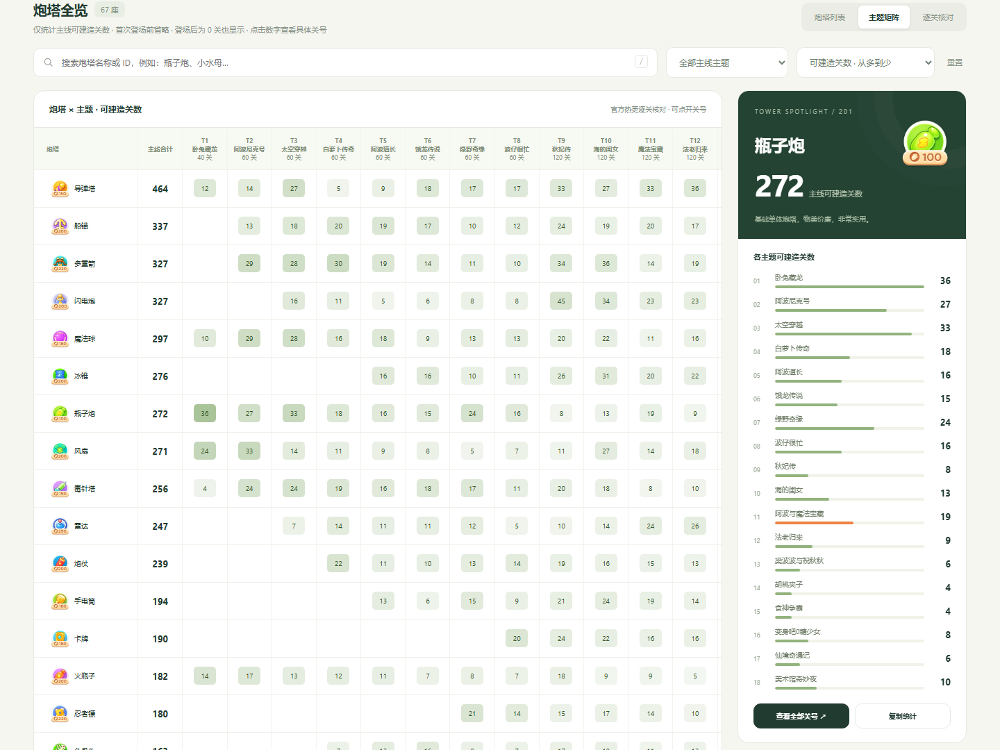
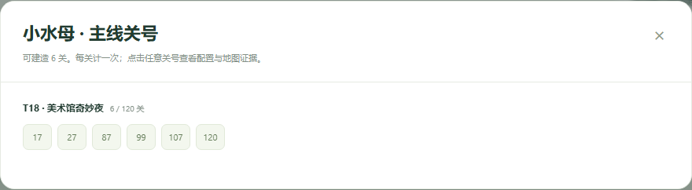
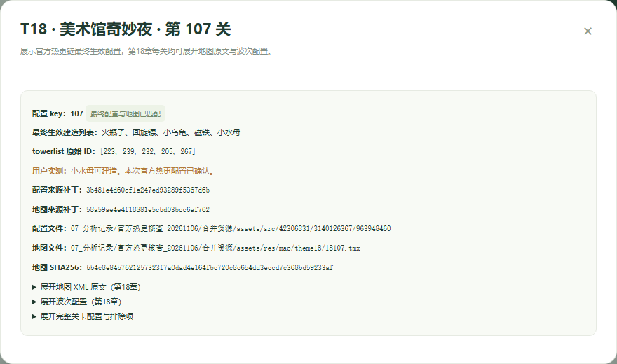
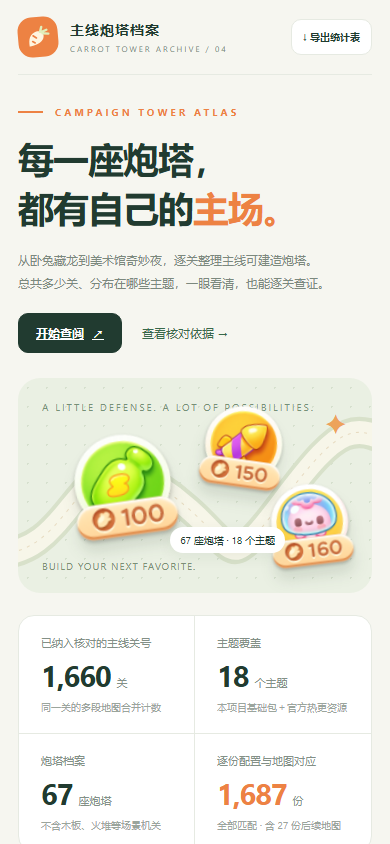
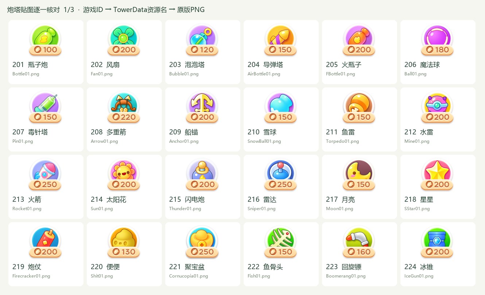
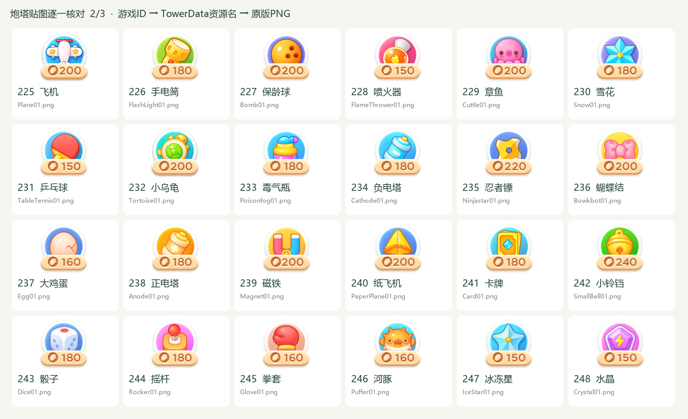
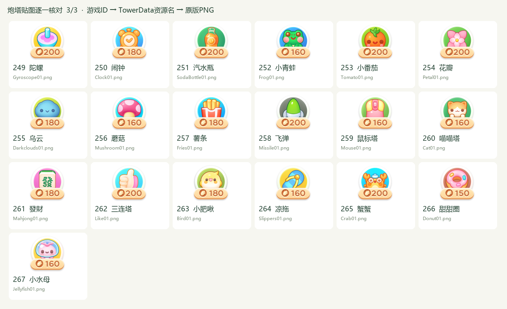

<div align="center">

# 保卫萝卜4 · 主线炮塔档案

**每一座炮塔，都有自己的主场。**

逐关整理主线可建造炮塔，查看总关数、主题分布与具体关号。


[下载离线页面](https://raw.githubusercontent.com/mlqj32/luobo4-tower-stats/main/index.html) · [统计 CSV](data/tower-counts.csv) · [逐关清单](data/level-audit.csv) · [数据口径](docs/data-notes.md)

</div>


## 这个项目可以查什么

瓶子炮主线总共能建多少关？船锚在哪些主题更常见？小水母第十八章到底是哪几关能建？某座塔登场后，有没有整章一次都不给建？

本项目把这些问题整理成一个可离线打开的 HTML 页面。**唯一统计口径是“主线可建造关数”**：读取每关实际生效配置中的 `towerlist`，每座炮塔每个关号只计一次。

| 可以做的事 | 页面中的操作 |
| --- | --- |
| 看总出场数 | 查看“主线合计”，可按多到少、少到多排序 |
| 查单个主题 | 用主题筛选器选择章节，查看该主题关数 |
| 对比所有主题 | 切换“主题矩阵”，横向查看18个主题 |
| 查具体关号 | 点击任意关数，展开对应关号清单 |
| 看逐关依据 | 点击关号，查看建造列表、炮塔ID、地图哈希和资源来源 |
| 复核第十八章 | 展开地图XML原文、波次及完整关卡配置 |
| 保存或分享 | 导出CSV、JSON，或使用打印 / 存为PDF |
| 在手机上查阅 | 页面提供适配窄屏的布局 |

## 打开方式

**只想使用统计页面：**

1. 在仓库右上角选择 **Code → Download ZIP**，下载并解压。
2. 双击解压目录中的 **`index.html`**，用浏览器打开。
3. 搜索炮塔，选择主题，点击关数查看明细。

页面的统计数据、样式、脚本和67张炮塔图标全部内嵌。**单独保存 `index.html` 就可以使用，不需要安装依赖，也不需要联网。**

上方“下载离线页面”链接打开的是HTML原文，可使用浏览器“另存为”保存为 `index.html`。GitHub文件预览页显示源码；下载后在本地浏览器打开即可看到完整页面。

需要通过本地地址访问时，也可以运行：

```bash
git clone https://github.com/mlqj32/luobo4-tower-stats.git
cd luobo4-tower-stats
python -m http.server 8000
```

然后访问 `http://localhost:8000`。此方式与直接双击打开使用同一份页面。

## 页面导览

### 01 / 一眼查看主题分布

列表展示主线合计，右侧展示所选炮塔从首次登场开始的所有主题。主题矩阵适合比较不同炮塔在同一章节中的分配。



**零值显示规则：**

- 首次可建造主题之前的零值留空，减少无意义信息。
- 从首次登场主题开始，每个主题都保留；没有可建造关卡时明确显示 **0**。
- 侧栏、矩阵、关号弹窗和CSV使用相同规则。例如水晶第15主题、乌云第18主题会显示0关。

### 02 / 点击数字，直接看到是哪几关

例如第十八章的小水母，完整热更配置中是 **17、27、87、99、107、120，共6关**。点击关号可以继续追溯对应证据。



### 03 / 每一个数字，都能回到原始关卡

第十八章107关的最终可建造列表为：**回旋镖、磁铁、小乌龟、火瓶子、小水母**。证据弹窗同时保留原始 `towerlist`、来源补丁、地图SHA256和完整关卡配置；地图XML与波次配置可以展开。



### 04 / 手机也能查

<div align="center">

</div>

## 当前统计范围

| 项目 | 当前快照 |
| --- | --- |
| 主题 | 第1—18章，卧兔藏龙至美术馆奇妙夜 |
| 主线关号 | **1,660关** |
| 配置与对应地图 | **1,687份** |
| 具名炮塔 | **67座，ID 201—267** |
| 热更基础版本 | `1.4.0 / 37304`，官方渠道 |
| 官方补丁链 | **36个补丁** |
| 末尾更新标识 | **`4219b0841d`** |
| 官方接口最近核查 | **2026-11-06 18:17:50，北京时间** |
| 第十八章 | 120关地图、建造表、波次均已逐关核对 |
| 第十九章 | 不纳入本页统计 |

第10主题“海的闺女”包含27份同关号的后续地图，所以配置数大于关号数。同一关的多段地图取可建造炮塔并集，合并后每座炮塔只计一关。

当前快照的一些例子：

| 炮塔 | 主线可建造关数 | 第十八章可建造关数 |
| --- | ---: | ---: |
| 导弹塔 | **464** | 26 |
| 船锚 | **337** | 33 |
| 瓶子炮 | **272** | 10 |
| 负电塔 | **63** | 4 |
| 小铃铛 | **40** | 3 |
| 甜甜圈 | **13** | 13 |
| 小水母 | **6** | 6 |

完整67座炮塔的主题分布见 [统计CSV](data/tower-counts.csv) 或离线页面。

> 数据快照以表中的核查时间和更新标识为准。仓库页面本身不会联网自动更新。

## 怎样统计，怎样核对

### 一个口径：能否在关卡中建造

计入条件是炮塔ID出现在该关最终生效的 **`towerlist`** 中。

| 资源里的信息 | 是否直接计入 |
| --- | --- |
| `towerlist` 中的具名炮塔 | **计入** |
| 同关后续地图新增的可建造炮塔 | 合并关号，取并集 |
| 地图上预先放好的炮塔 | 不直接计入 |
| 宝箱奖励炮塔 | 不直接计入 |
| 贴图预加载列表 | 不直接计入 |
| 木板281、火堆1276等机关 | 不计作炮塔 |

“出场”在这个项目中始终指**可建造关数**，不能直接换算成玩家实际建造次数、使用时长或炮塔强度。

### 完整热更：解决第十八章后期资源差异

基础安装包中的第十八章后期曾存在49张相同的简略地图，部分建造列表与真机观察不一致。取得官方热更链后，按补丁顺序覆盖基础资源，再逐关重新读取建造表、地图和波次。

- 第十八章 **71—120关的50条建造列表**均与基础包不同。
- 原来的49张重复地图均已替换，最终120张地图的SHA256各不相同。
- 小水母的107、120关已由热更表直接确认；完整名单还包括87、99关。
- 第36个补丁核对后，第1—18章统计与上一版完整热更结果一致。

### 独立复核：从结果反查到关号集合

源资源核查阶段，一路按覆盖索引读取最终资源，另一路从末尾补丁向前扫描实际压缩包，比较各关配置及地图哈希，再独立汇总炮塔关号集合。

**67座炮塔 × 18个主题，共1,206项统计全部匹配**；1,687份配置与地图均已核对，对应波次也已检查。独立结果保存在 [independent-check.json](data/independent-check.json)。

仓库内的验证脚本进一步检查发布快照中的统计、关号、CSV、图标与页面构建是否一致。原始补丁链的取得和复核方法详见 [数据说明](docs/data-notes.md)。

## 炮塔名称与贴图

67座炮塔的图标通过32位和64位 `TowerData` 的ID与资源映射逐一对应，并保存PNG的SHA256。特别容易混淆的三组已明确核准：

| 图标 | 炮塔 | ID | 资源名 |
| --- | --- | ---: | --- |
|  | 导弹塔 | 204 | `AirBottle` |
|  | 飞弹 | 258 | `Missile` |
|  | 三连塔 | 262 | `Like` |

**绿色弹头对应飞弹。**完整映射见 [icon-mapping.json](data/icon-mapping.json)。

<details>
<summary><strong>展开全部67座炮塔的名称与贴图核对图</strong></summary>







</details>

## 数据与项目结构

```text
luobo4-tower-stats/
├── index.html                  # 可直接使用的完整离线页面
├── assets/towers/              # 67张已核对的PNG图标
├── data/
│   ├── mainline.json            # 全量逐关数据、汇总与来源记录
│   ├── tower-counts.csv         # 每塔总数及18主题关数
│   ├── level-audit.csv          # 1,687份配置的逐项清单
│   ├── chapter18-levels.csv     # 第十八章120关文件核查
│   ├── independent-check.json  # 独立复核结果
│   ├── icon-mapping.json        # 图标映射与哈希证据
│   ├── latest-update.json       # 官方更新接口核查摘要
│   └── browser-check.json       # 发布页面的浏览器验证结果
├── docs/
│   ├── data-notes.md            # 统计方法与字段说明
│   └── images/                 # README真实页面截图及核对图
├── tools/
│   ├── build.py                # 用本仓库资源重建单文件HTML
│   ├── verify.py               # 验证数据、图标、链接及构建一致性
│   └── capture.py              # 浏览器检查并生成页面截图
└── web/template.html           # 页面模板
```

CSV使用UTF-8 BOM编码，方便用Excel打开。首次登场前的主题单元格留空，登场后的零值写为 `0`。

## 重新生成与验证

使用 **Python 3.10或更新版本**，构建与数据检查只依赖标准库：

```bash
python tools/build.py
python tools/verify.py
```

可选的浏览器验证与截图需要Playwright：

```bash
python -m pip install playwright
python -m playwright install chromium
python tools/capture.py
```

浏览器检查涵盖离线加载、67张图标、主题矩阵、小水母六关追溯、零值主题、CSV导出和手机布局，并确认运行时没有外网请求或JavaScript错误。

这些命令重建和复核**当前仓库快照**。更新游戏版本时，需要先重新取得完整资源链并逐关核对，再同步数据文件；仅修改版本号或运行构建脚本不会取得新关卡。

---

<div align="center">

**从“这座塔好像很常见”，到“它具体出现在哪几关”。**

保卫萝卜4相关名称与美术资源归原权利方所有；本项目为玩家制作的统计整理页面。

</div>
